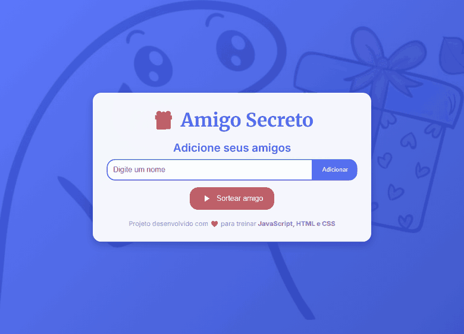

# Amigo Secreto

Aplicação web para realizar sorteios de amigo secreto, com validação de nomes duplicados e sorteio sem repetição.



## Funcionalidades

- Adicionar e remover participantes
- Impedir nomes duplicados
- Sortear cada participante apenas uma vez
- Exibir mensagens de sucesso e erro em tempo real
- Layout responsivo

## Tecnologias

- HTML5
- CSS3
- JavaScript (ES6+)

## Estrutura do projeto

```
Challenge_Amigo_Secreto/
├── index.html
├── style.css
├── app.js
└── assets/bg.jpg
demo/amigo-secreto.gif
```

## Como executar

1. Clone o repositório:

```bash
git clone https://github.com/GilvamOliveira/Projeto-Alura-Amigo-Oculto.git
```

2. Abra `Challenge_Amigo_Secreto/index.html` no navegador.

O projeto não possui dependências nem etapa de build.

## Melhorias futuras

- Animação mais elaborada durante o sorteio
- Exportação dos resultados em PDF
- Envio dos resultados por e-mail

## Autor

Gilvam Oliveira

- GitHub: [github.com/GilvamOliveira](https://github.com/GilvamOliveira)
- LinkedIn: [linkedin.com/in/gilvam-oliveira](https://www.linkedin.com/in/gilvam-oliveira/)
